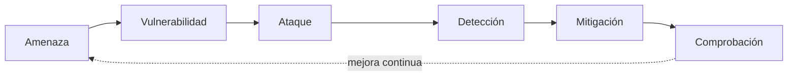

# UD01 · Casos de ataque y defensa



En esta página aplicas el vocabulario de la unidad (activo, amenaza, vulnerabilidad, riesgo, incidente) a **ataques reales y recientes**. Cada caso sigue el mismo ciclo, que se repite en todas las unidades del módulo:



| Caso | Ataque | Caso real | Tipo |
|---|---|---|---|
| [1.A](#caso-1a--ingeniería-social-contra-el-servicio-técnico) | Ingeniería social contra el servicio técnico (*help desk*) | Marks & Spencer y Co-op, 2025 | Supuesto + laboratorio |
| [1.B](#caso-1b--supermercados-sin-frío-dispositivos-expuestos-a-internet) | Toma de control de dispositivos expuestos a Internet | Supermercados franceses, octubre de 2026 | Análisis de riesgos |
| [1.C](#caso-1c--el-proveedor-como-puerta-de-entrada) | Ataque a través de un proveedor | Target (2013) y Ahold Delhaize (2024) | Análisis de riesgos + legal |
| [Búsqueda](#búsqueda-de-vulnerabilidades-cómo-se-investiga-un-cve) | Cómo se investiga un CVE: INCIBE-CERT, NVD, KEV, EPSS | — | Autónoma |

> [!NOTE]
> **Estos casos no se entregan.** Son trabajo autónomo o actividades de clase. Sirven para preparar la prueba (se pregunta la **interpretación** de un caso: identificar activo, amenaza, vulnerabilidad, fase del ataque y medida) y como ejemplos para el diagnóstico de la práctica integradora INT-1.



## Antes de empezar: ética y legalidad del laboratorio

Aprender cómo funciona un ataque es imprescindible para defenderse, pero **atacar un sistema ajeno es delito**, aunque sea «para probar» o «sin hacer daño». El Código Penal español castiga, entre otros:

| Artículo | Conducta |
|---|---|
| 197 bis | Acceder sin autorización a un sistema de información o interceptar transmisiones no públicas |
| 197 ter | Producir, adquirir o facilitar herramientas o contraseñas **con intención** de cometer los delitos anteriores |
| 264 y 264 bis | Borrar, dañar o hacer inaccesibles datos, u **obstaculizar o interrumpir** el funcionamiento de un sistema (aquí encaja una denegación de servicio) |

Por eso, en todo el módulo se aplican estas **normas de laboratorio**:

1. Solo se ataca a **máquinas virtuales propias** dentro de las redes internas de VirtualBox (`sad-atk`, `sad-lan`, `sad-dmz`, `SAD-NAT`). Nunca a la red del centro, a la de casa ni a ninguna dirección de Internet.
2. La máquina atacante (`atacante`, Debian 13 o Kali Linux) **no tiene salida a Internet** mientras se ejecutan las pruebas. Primero se instalan las herramientas y después se desconecta el adaptador NAT.
3. Antes de cada caso se hace una **instantánea** de las máquinas implicadas.
4. Las búsquedas de vulnerabilidades en Internet son **pasivas**: se consultan bases de datos públicas, nunca se escanean equipos de terceros.

> [!WARNING]
> Escanear con Nmap una dirección de Internet que no es tuya, probar contraseñas en un servicio ajeno o lanzar tráfico de inundación contra una web puede tener consecuencias penales y disciplinarias. Si tienes dudas sobre si algo está permitido, **pregunta antes**.

---

## Caso 1.A · Ingeniería social contra el servicio técnico



### El caso real

En **abril de 2025** dos grandes cadenas británicas de distribución, **Marks & Spencer** y **Co-op**, sufrieron ciberataques que paralizaron sus ventas por Internet, vaciaron estanterías y obligaron a desconectar sistemas. Los análisis publicados atribuyen el acceso inicial al grupo conocido como *Scattered Spider*, cuya técnica principal es la **ingeniería social contra el servicio técnico**: llamar al *help desk* haciéndose pasar por un empleado para que le restablezcan la contraseña o le registren un nuevo dispositivo de doble factor. El *Cyber Monitoring Centre* británico estimó un impacto económico de entre **270 y 440 millones de libras**.

Lo importante para nosotros: **no hizo falta ninguna vulnerabilidad técnica** para entrar. Bastó un procedimiento débil.

### Análisis con el ciclo

| Fase | En este caso |
|---|---|
| **Activo** | Cuentas de empleados con acceso a la red interna (sobre todo las privilegiadas) |
| **Amenaza** | Grupo criminal con motivación económica (extorsión con *ransomware*) |
| **Vulnerabilidad** | El servicio técnico restablece contraseñas o MFA solo con datos que un atacante puede averiguar (nombre, número de empleado, departamento) |
| **Ataque** | Llamada suplantando a un empleado → restablecimiento de credenciales → acceso remoto → movimiento lateral → cifrado y robo de datos |
| **Detección** | Restablecimientos de contraseña o MFA fuera de lo habitual; inicio de sesión desde un dispositivo o país nuevo justo después de un restablecimiento |
| **Mitigación** | Procedimiento de verificación de identidad que no dependa de datos públicos; MFA resistente al *phishing*; doble aprobación para cuentas privilegiadas; formación del servicio técnico |
| **Comprobación** | Simulacro: alguien del equipo intenta el restablecimiento con datos públicos y debe ser rechazado |

### Actividad 1: procedimiento de verificación de identidad

Redacta, para la clínica Mediterránea Dental, el procedimiento que debe seguir el servicio técnico cuando alguien llama pidiendo un cambio de contraseña. Debe incluir como mínimo:

1. **Devolución de llamada** al teléfono que figura en el directorio interno (no al número desde el que llaman).
2. Verificación por un **segundo canal** (responsable directo, presencial o un código enviado al dispositivo ya registrado).
3. Prohibición de **registrar un nuevo dispositivo MFA** por teléfono sin aprobación del responsable.
4. **Doble aprobación** para cuentas administrativas.
5. **Registro** de cada solicitud (quién, cuándo, cómo se verificó) y aviso automático al usuario por correo.

### Actividad 2: detectar cambios de credenciales en Linux

En un servidor Debian 13 del laboratorio, los cambios de contraseña quedan en el registro del sistema (*journal*). Simula el trabajo del servicio técnico y después búscalo como lo haría un analista.

```bash
# 1. Crea un usuario de prueba y cámbiale la contraseña como si fueras el servicio técnico
sudo useradd -m -s /bin/bash empleado1
sudo passwd empleado1

# 2. Busca en el registro los cambios de contraseña de las últimas 24 horas
sudo journalctl --since "24 hours ago" _COMM=passwd --no-pager

# 3. Consulta cuándo se cambió por última vez la contraseña de la cuenta
sudo chage -l empleado1 | head -n 1

# 4. Comprueba los inicios de sesión posteriores (quién entró, desde dónde y cuándo)
last -n 10
```

- `journalctl` consulta el registro de systemd; `_COMM=passwd` filtra los mensajes generados por la orden `passwd`.
- `chage -l` muestra la política de caducidad de la contraseña de un usuario y la fecha del último cambio.
- `last` lee `/var/log/wtmp` y lista los últimos inicios de sesión. En Debian 13, si `last` no está instalado, usa `sudo apt install -y wtmpdb` o consulta `journalctl -u ssh`.

{}
`journalctl` muestra una línea parecida a `passwd[1234]: pam_unix(passwd:chauthtok): password changed for empleado1`. Un analista correlaciona ese cambio con el siguiente inicio de sesión: si la cuenta entra **desde una IP o un horario que nunca había usado** pocos minutos después del restablecimiento, hay que tratarlo como un posible incidente (fase de detección y análisis de la gestión de incidentes).
{}

### Preguntas de análisis

1. ¿Por qué un SMS no se considera un segundo factor resistente al *phishing*? ¿Qué alternativa propondrías?
2. ¿Qué principio de seguridad (confidencialidad, integridad, disponibilidad…) se vio más afectado en el caso real? Justifica que se vieron afectados varios.
3. Clasifica este ataque según la tabla de ataques de la [teoría](/ud01/ud01-teoria/): ¿es interceptación, interrupción, modificación o fabricación?

### Variantes: Linux, Windows 11 y web


{}
Los cambios de contraseña quedan en el *journal*: `sudo journalctl _COMM=passwd --since "24 hours ago"`, `chage -l usuario` y `last -n 10` (ver arriba).
{}
{}
Abre **PowerShell** (`Win` + `X` → *Terminal*; para lo que pida administrador, *Terminal (administrador)*).

Windows registra los cambios de contraseña en el registro de **Seguridad** (Visor de eventos → *Registros de Windows* → *Seguridad*). Los identificadores que debe conocer un analista:

| Id. de evento | Significado |
|---|---|
| 4720 | Se creó una cuenta de usuario |
| 4723 | Un usuario intentó **cambiar** su contraseña |
| 4724 | Un administrador intentó **restablecer** la contraseña de otra cuenta |
| 4738 | Se modificó una cuenta de usuario |
| 4624 / 4625 | Inicio de sesión correcto / fallido |

```powershell
# 1. Crea un usuario de prueba y restablece su contraseña como lo haría el servicio técnico (como administrador)
net user empleado1 /add *
net user empleado1 *                       # pide la nueva contraseña dos veces

# 2. Comprueba que la auditoría de cuentas está activada (debe constar «Correcto»)
auditpol /get /subcategory:"User Account Management"

# 3. Busca los restablecimientos de las últimas 24 horas
Get-WinEvent -FilterHashtable @{LogName='Security'; Id=4723,4724; StartTime=(Get-Date).AddDays(-1)} |
  Select-Object TimeCreated, Id, @{n='Mensaje';e={$_.Message.Split("`n")[0]}}

# 4. Cuándo se cambió por última vez la contraseña
Get-LocalUser empleado1 | Select-Object Name, PasswordLastSet
```

- `net user nombre *` pide la contraseña sin dejarla escrita en el historial.
- `auditpol` consulta qué eventos audita el equipo; si no aparece «Correcto», actívalo con `auditpol /set /subcategory:"User Account Management" /success:enable`.
- En un dominio de Active Directory, el equivalente es `Get-ADUser empleado1 -Properties PasswordLastSet`.

Al terminar: `net user empleado1 /delete`.
{}
{}
No necesitas instalar nada para comprobar la exposición de tus cuentas:

1. **[Have I Been Pwned](https://haveibeenpwned.com/)**: escribe tu correo y comprueba si aparece en filtraciones conocidas.
2. **Actividad reciente de tu cuenta** (Google: *Seguridad → Tus dispositivos*; Microsoft: *Seguridad → Actividad de inicio de sesión*): ¿hay dispositivos o ubicaciones que no reconoces justo después de un cambio de contraseña? Es la misma señal que busca un analista.
3. **Análisis de cabeceras de un correo sospechoso**: pega las cabeceras en el [Message Header Analyzer de Google](https://toolbox.googleapps.com/apps/messageheader/) para ver el recorrido real del mensaje (práctica 1.5).
{}


---

## Caso 1.B · Supermercados sin frío: dispositivos expuestos a Internet



### El caso real

El fin de semana del **11 y 12 de octubre de 2026**, cientos de supermercados de Francia (de cadenas como Intermarché, Netto, Carrefour, Coopérative U o Monoprix) vieron cómo sus **sistemas de refrigeración** se ponían en ciclo de descongelación: las cámaras llegaron a temperaturas muy altas durante horas y se perdieron carnes, pescados, lácteos y congelados. Los atacantes entraron en los **controladores de supervisión remota** de refrigeración del fabricante Danfoss (modelos AK-SM 800/800A y AK-SC 355) y enviaron **órdenes de mantenimiento válidas**: no necesitaron instalar *malware*.

Lo que hizo posible el ataque:

- **Exposición a Internet**: según Censys, el 11 de octubre había 2 991 paneles de este tipo accesibles desde Internet, 1 825 de ellos en Francia. Tres días después, en Francia quedaban 537 (una caída del 71 %): los operadores los **desconectaron** de Internet.
- **Vulnerabilidades conocidas** en el AK-SM 800A, publicadas y corregidas en 2025: **CVE-2025-41450** (una «contraseña diaria» oculta, derivada de la fecha, que salta la autenticación del administrador), **CVE-2025-41451** (inyección de órdenes en un campo del formulario) y **CVE-2025-41452** (manipulación de la configuración del servidor web). Se corrigen con el *firmware* R4.3.1 o posterior.
- **Equipos sin soporte**: los modelos más antiguos (AK-SM 800 y AK-SC 355) ya no reciben actualizaciones, de modo que no hay parche posible.

Nadie reivindicó el ataque ni pidió rescate, lo que hace pensar en un sabotaje con motivación política. Una cadena, Picard, no se vio afectada porque su refrigeración se controla **tienda a tienda**, sin una consola central.



### Actividad: matriz de riesgos del caso

Usa el método de la unidad (**riesgo = probabilidad × impacto**, escala 1-3) para valorar, **antes del ataque**, los riesgos de una cadena de supermercados con estos controladores:

| Activo | Amenaza | Vulnerabilidad | P | I | Riesgo | Medida | Riesgo residual |
|---|---|---|--:|--:|--:|---|--:|
| Controlador de refrigeración | Sabotaje remoto | Panel accesible desde Internet | | | | | |
| Controlador de refrigeración | Explotación de un CVE conocido | *Firmware* sin actualizar | | | | | |
| Controlador de refrigeración | Explotación sin parche posible | Modelo sin soporte del fabricante | | | | | |
| Stock de alimentos | Pérdida por temperatura | Sin alarma independiente del controlador | | | | | |
| Consola central | Ataque a toda la cadena a la vez | Gestión centralizada sin segmentar | | | | | |

{}
- La **exposición a Internet** eleva mucho la probabilidad: los buscadores de dispositivos (Shodan, Censys) indexan estos paneles y cualquiera puede encontrarlos.
- Un equipo **sin soporte** no se puede «parchear»: la medida es **sustituirlo** o **aislarlo** (sacarlo de Internet y acceder solo por VPN).
- Una **alarma de temperatura independiente** (otro sensor, otro proveedor) no evita el ataque, pero reduce el **impacto**: detecta el problema a tiempo.
- La **centralización** facilita la gestión, pero convierte la consola en un punto que, si cae, afecta a toda la cadena. Esta idea volverá en la UD07 (punto único de fallo).
{}

### Preguntas de análisis

1. ¿Por qué el ataque afectó a la **disponibilidad** y a la **integridad** pero, según lo publicado, no a la confidencialidad?
2. ¿Qué fase de la gestión de incidentes aplicaron los operadores al desconectar los paneles de Internet: contención, erradicación o recuperación?
3. La regla general que repiten los expertos es: «estos controladores **nunca** deben conectarse directamente a Internet». ¿Qué alternativa segura propondrías para el mantenimiento remoto? (Lo implementarás en la UD06 con WireGuard).

### Variantes: Linux, Windows 11 y web


{}
Comprueba qué escucha un equipo con `sudo ss -tulpn` y qué ve un atacante desde fuera con `nmap -sV -p- IP`.
{}
{}
Abre **PowerShell** (`Win` + `X` → *Terminal*; para lo que pida administrador, *Terminal (administrador)*).

```powershell
# Qué puertos están a la escucha en ESTE equipo y qué programa los abre
Get-NetTCPConnection -State Listen |
  Select-Object LocalAddress, LocalPort, @{n='Proceso';e={(Get-Process -Id $_.OwningProcess).ProcessName}} |
  Sort-Object LocalPort

# ¿Es alcanzable un puerto de OTRO equipo? (p. ej. el «panel» del laboratorio, puerto 8080)
Test-NetConnection -ComputerName 192.168.100.100 -Port 8080
```

- `LocalAddress` **0.0.0.0** o **::** significa «escucha en todas las interfaces» (accesible desde la red); **127.0.0.1**, solo desde el propio equipo.
- `Test-NetConnection` devuelve `TcpTestSucceeded : True` si el puerto responde. Es la comprobación equivalente a la de un atacante que busca paneles expuestos.
{}
{}
Así encuentran los atacantes (y los investigadores) los dispositivos expuestos, **sin escanear nada ellos mismos**:

1. **[Shodan](https://www.shodan.io/)** y **[Censys](https://search.censys.io/)** indexan Internet de forma continua. Busca **tu propia IP pública** (la ves en un buscador con «cuál es mi IP») y comprueba qué muestran de tu casa o de tu centro.
2. Compara con el caso real: Censys contó **2 991 paneles Danfoss** accesibles el 11 de octubre y **537** en Francia tres días después.
3. En INCIBE existe el proyecto **+Ciberseguridad**, que avisa a organizaciones con dispositivos vulnerables expuestos en España; consulta su página para ver el alcance por comunidades.

> Solo consulta datos **públicos** y tu propia IP: no pruebes accesos en dispositivos que encuentres.
{}


---

## Caso 1.C · El proveedor como puerta de entrada



### Los casos reales

- **Target (Estados Unidos, 2013).** Los atacantes robaron las credenciales de una empresa de **climatización** que tenía acceso remoto a la red de la cadena para gestionar facturas. Desde ahí llegaron a los **terminales de punto de venta** e instalaron *malware* que capturaba los datos de las tarjetas: unos 40 millones de tarjetas afectadas. La red de los proveedores y la de los cajeros **no estaban separadas**.
- **Ahold Delhaize (Estados Unidos, noviembre de 2024).** El grupo propietario de cadenas como Food Lion, Stop & Shop o Hannaford sufrió un ataque de *ransomware* (reivindicado por *INC Ransom*) que provocó problemas en farmacias y supermercados. En 2025 la empresa notificó a las autoridades que se habían robado datos de **2 242 521 personas** (empleados y antiguos empleados), incluyendo documentos de identidad, datos bancarios y de salud.
- **Albert Heijn (Países Bajos, octubre de 2026).** La mayor cadena neerlandesa, del mismo grupo Ahold Delhaize, desconectó sistemas de forma preventiva tras un incidente: se pararon centros de distribución y la venta por Internet, pero **las tiendas siguieron abiertas y cobrando**. Es un ejemplo de funcionamiento en **modo degradado** (lo retomarás en la UD07).

### Actividad

1. Para Mediterránea Dental, haz una lista de **terceros con acceso** a sus sistemas (empresa de mantenimiento informático, proveedor del software de citas, técnico de la máquina de rayos X, gestoría…). Para cada uno indica qué acceso tiene, cómo se autentica y qué medida reduciría el riesgo (cuenta individual, acceso solo por VPN, horario limitado, registro de sesiones, cláusula de seguridad en el contrato).
2. Supón que la clínica sufre un robo de datos de pacientes a través del técnico de rayos X. Según el RGPD:
   - ¿A quién hay que notificar y en qué plazo? (Pista: autoridad de control y **72 horas**).
   - ¿Cuándo hay que comunicarlo también a los pacientes?
   - ¿Qué figura legal tiene el proveedor (responsable o encargado del tratamiento) y qué documento debería haber firmado?
3. ¿A qué organismo se notifica un incidente en España si eres una empresa privada? ¿Y si eres un centro público? (Consulta el apartado de notificación de incidentes de la [teoría](/ud01/ud01-teoria/)).

{}
- El proveedor que trata datos por cuenta de la clínica es **encargado del tratamiento** y debe tener un **contrato de encargo** (art. 28 RGPD).
- La notificación a la AEPD es obligatoria salvo que sea improbable que la brecha suponga un riesgo; la comunicación a los interesados, cuando el riesgo es **alto** (datos de salud: normalmente sí).
- Empresas y ciudadanía notifican a **INCIBE-CERT**; el sector público, al **CCN-CERT**.
{}

---

## Búsqueda de vulnerabilidades: cómo se investiga un CVE



Cuando aparece una noticia como la de los supermercados, un administrador de sistemas debe responder rápido a tres preguntas: **¿me afecta?, ¿es grave?, ¿se está explotando ya?** Para eso se consultan estas fuentes, todas públicas y gratuitas:

| Fuente | Qué aporta | Enlace |
|---|---|---|
| **INCIBE-CERT · Avisos** | Avisos en castellano sobre vulnerabilidades relevantes, con solución recomendada | [incibe.es/incibe-cert/alerta-temprana/avisos](https://www.incibe.es/incibe-cert/alerta-temprana/avisos) |
| **INCIBE-CERT · Vulnerabilidades** | Catálogo de CVE traducido al castellano, buscable por producto | [incibe.es/incibe-cert/alerta-temprana/vulnerabilidades](https://www.incibe.es/incibe-cert/alerta-temprana/vulnerabilidades) |
| **INCIBE · Avisos para empresas** | Avisos sencillos orientados a pymes (*phishing*, fraudes, actualizaciones urgentes) | [incibe.es/empresas/avisos](https://www.incibe.es/empresas/avisos) |
| **NVD (NIST)** | Ficha oficial del CVE: puntuación CVSS, vector, productos afectados, referencias | [nvd.nist.gov](https://nvd.nist.gov/) |
| **CISA KEV** | Catálogo de vulnerabilidades **explotadas activamente** | [cisa.gov/known-exploited-vulnerabilities-catalog](https://www.cisa.gov/known-exploited-vulnerabilities-catalog) |
| **EPSS (FIRST)** | Probabilidad estimada de que una vulnerabilidad se explote en los próximos 30 días | [first.org/epss](https://www.first.org/epss/) |
| **Avisos del fabricante** | La fuente primaria: versiones afectadas y parche | Web de seguridad de cada fabricante |

### Actividad: ficha de una vulnerabilidad

Elige **uno** de estos CVE y completa la ficha:

- **CVE-2025-41450** (controladores de refrigeración Danfoss, caso 1.B).
- **CVE-2023-34362** (MOVEit Transfer, inyección SQL usada en 2023 para robar datos de miles de organizaciones; la estudiarás en la UD04).
- **CVE-2024-6387** (*regreSSHion*, OpenSSH; ya aparece en la [teoría](/ud01/ud01-teoria/)).

| Campo | Respuesta |
|---|---|
| Producto y versiones afectadas | |
| Tipo de vulnerabilidad (CWE) | |
| Puntuación CVSS y vector | |
| ¿Qué significa cada parte del vector (AV, AC, PR, UI…)? | |
| ¿Está en el catálogo KEV? ¿Desde qué fecha? | |
| Puntuación EPSS actual | |
| ¿Hay aviso de INCIBE-CERT? Enlace | |
| Solución o mitigación recomendada | |
| ¿Afectaría a Mediterránea Dental? ¿Por qué? | |

{}
Un vector como `CVSS:3.1/AV:N/AC:L/PR:N/UI:N/S:U/C:H/I:H/A:H` se lee así: **AV:N** se ataca por red (desde Internet), **AC:L** con baja complejidad, **PR:N** sin necesidad de credenciales, **UI:N** sin que ningún usuario haga nada, y el impacto en confidencialidad, integridad y disponibilidad es alto (**C:H/I:H/A:H**). Es la combinación más peligrosa: una vulnerabilidad así, en un equipo expuesto a Internet, debe corregirse **de inmediato**. CVSS mide la **gravedad**, no la **probabilidad** de ataque: por eso se combina con KEV (¿se explota ya?) y EPSS (¿es probable que se explote?).
{}

### Casos reales de la Línea 017 de INCIBE

INCIBE publica, de forma anónima, **casos reales** atendidos por su Línea de Ayuda en Ciberseguridad (**017**): pymes con *ransomware*, tiendas *online* atacadas, fraudes por suplantación… Cada caso explica qué pasó y qué se recomendó. Son un material excelente para practicar el análisis de esta unidad.

**Actividad:** entra en los [casos reales de INCIBE](https://www.incibe.es/linea-de-ayuda-en-ciberseguridad/casos-reales), filtra por la temática *Ingeniería social* o *Ransomware*, elige un caso y complétalo con la tabla del ciclo (activo, amenaza, vulnerabilidad, ataque, detección, mitigación, comprobación). Indica qué recomendaciones de INCIBE son **preventivas** y cuáles **reactivas**.

> [!TIP]
> Suscríbete al **boletín** o a la fuente RSS de avisos de INCIBE-CERT. En el trabajo real, revisar los avisos cada mañana es una tarea habitual del equipo de sistemas.

### Variantes: Linux, Windows 11 y web


{}
`apt list --upgradable`, `debsecan --suite trixie --only-fixed` (caso 4.C).
{}
{}
Abre **PowerShell** (`Win` + `X` → *Terminal*; para lo que pida administrador, *Terminal (administrador)*).

```powershell
winget upgrade                              # programas con actualización disponible
Get-HotFix | Sort-Object InstalledOn -Descending | Select-Object -First 5   # últimas actualizaciones de Windows
Get-MpComputerStatus | Select-Object AMProductVersion, AntivirusSignatureLastUpdated   # Microsoft Defender
```

Para investigar un CVE de Microsoft, la fuente primaria es la **[Guía de actualizaciones de seguridad del MSRC](https://msrc.microsoft.com/update-guide)**, con la gravedad, los equipos afectados y el parche (número KB).
{}
{}
Las consultas de la ficha pueden automatizarse con las **API públicas** de las fuentes:

```powershell
# Probabilidad de explotación (EPSS) de un CVE
(Invoke-RestMethod "https://api.first.org/data/v1/epss?cve=CVE-2025-41450").data

# ¿Está en el catálogo KEV de CISA? (descarga el JSON y filtra)
$kev = Invoke-RestMethod "https://www.cisa.gov/sites/default/files/feeds/known_exploited_vulnerabilities.json"
$kev.vulnerabilities | Where-Object cveID -eq 'CVE-2023-34362' | Select-Object cveID, vendorProject, dateAdded, knownRansomwareCampaignUse
```

En Linux o en macOS, `curl -s URL | jq` hace lo mismo. Consulta también la ficha en [NVD](https://nvd.nist.gov/) para el vector CVSS.
{}


---

## Qué debes saber explicar

- Identificar en un caso real el **activo**, la **amenaza**, la **vulnerabilidad**, el **ataque** y la **medida**.
- Explicar por qué la ingeniería social puede saltarse controles técnicos y cómo se mitiga con **procedimientos**.
- Calcular un **riesgo** y un **riesgo residual** con la escala 1-3.
- Distinguir **CVE**, **CVSS**, **KEV** y **EPSS**, y saber dónde consultarlos (INCIBE-CERT, NVD).
- Saber a quién se notifica un incidente (INCIBE-CERT, CCN-CERT, AEPD) y el plazo de **72 horas** del RGPD.

## Referencias

- INCIBE-CERT. [Avisos de seguridad](https://www.incibe.es/incibe-cert/alerta-temprana/avisos) y [catálogo de vulnerabilidades](https://www.incibe.es/incibe-cert/alerta-temprana/vulnerabilidades).
- INCIBE-CERT. [¿Conoces la Guía nacional de notificación y gestión de ciberincidentes?](https://www.incibe.es/incibe-cert/blog/conoces-guia-nacional-notificacion-y-gestion-ciberincidentes).
- INCIBE. [Casos reales de la Línea de Ayuda en Ciberseguridad 017](https://www.incibe.es/linea-de-ayuda-en-ciberseguridad/casos-reales).
- The Hacker News (2025). [Scattered Spider behind cyberattacks on M&S and Co-op](https://thehackernews.com/2025/06/scattered-spider-behind-cyberattacks-on.html).
- Infosecurity Magazine (2026). [France: Internet-exposed Danfoss controllers drop 71% after cyber-attack](https://www.infosecurity-magazine.com/news/france-expose-danfoss-controllers/).
- Escudo Digital (2026). [Crónica del ciberataque a los supermercados franceses](https://www.escudodigital.com/ciberseguridad/tres-anos-de-advertencias-ignoradas-la-cronica-del-ciberataque-a-los-supermercados-franceses.html).
- SecurityWeek (2025). [Ahold Delhaize data breach impacts 2.2 million people](https://www.securityweek.com/ahold-delhaize-data-breach-impacts-2-2-million-people/).
- U.S. Senate Committee on Commerce (2014). *A "Kill Chain" Analysis of the 2013 Target Data Breach*.
- [Código Penal](https://www.boe.es/buscar/act.php?id=BOE-A-1995-25444), arts. 197 bis, 197 ter, 264 y 264 bis.
- FIRST. [CVSS v3.1 Specification](https://www.first.org/cvss/v3.1/specification-document) y [EPSS](https://www.first.org/epss/).
