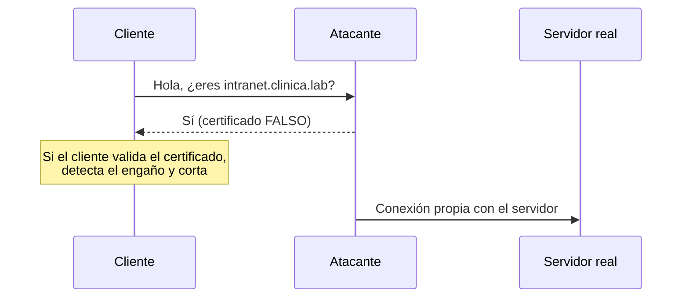

# UD03 · Casos de ataque y defensa



La criptografía protege la información **si se usa bien**. Los atacantes rara vez «rompen» AES o RSA: aprovechan que alguien **acepta un certificado falso**, que las contraseñas se guardan con un *hash* inadecuado o que una biblioteca criptográfica tiene un fallo. Estos casos muestran esos errores y cómo se corrigen.

| Caso | Ataque | Caso real | Tipo |
|---|---|---|---|
| [3.A](#caso-3a--intermediario-con-un-certificado-falso) | *Man-in-the-middle* (MITM) con un certificado falso | Wi-Fi falsas, inspección TLS mal configurada | Laboratorio |
| [3.B](#caso-3b--robo-de-una-base-de-datos-de-contraseñas) | *Cracking* de contraseñas tras el robo de una base de datos | LinkedIn (2012) | Laboratorio |
| [3.C](#caso-3c--cuando-el-fallo-está-en-la-biblioteca-heartbleed) | Fallo en la implementación de TLS | Heartbleed (2014) | Análisis |
| [Búsqueda](#búsqueda-de-vulnerabilidades-en-bibliotecas-y-configuraciones-tls) | Vulnerabilidades de OpenSSL y auditoría de TLS | — | Autónoma |

> [!IMPORTANT]
> Recuerda las [normas de laboratorio](/ud01/ud01-casos/#antes-de-empezar-ética-y-legalidad-del-laboratorio). Estos casos **no se entregan**. Reutilizan la CA propia y el servidor Nginx de las prácticas 3.5 y 3.6.

---

## Caso 3.A · Intermediario con un certificado falso



### Qué es un ataque de intermediario

En un ataque de **intermediario** (*man-in-the-middle*, MITM) el atacante se coloca **entre** el cliente y el servidor: el cliente cree que habla con el servidor, pero habla con el atacante, que reenvía (y puede leer o modificar) todo. Para colocarse en medio se usan técnicas de red (ARP *spoofing*, DNS falso, Wi-Fi gemela, que verás en la UD05). La criptografía **no impide** que el atacante se ponga en medio, pero sí que **pueda leer** el tráfico… siempre que el cliente **valide el certificado**.



### Ciclo del caso

| Fase | Descripción |
|---|---|
| **Vulnerabilidad** | Usuarios o programas que **ignoran los avisos de certificado** (`curl -k`, «Aceptar el riesgo y continuar»); webs sin HSTS |
| **Ataque** | El atacante redirige el nombre `intranet.clinica.lab` a su máquina y presenta un certificado autofirmado con ese nombre |
| **Detección** | Error de validación del certificado; emisor o huella (*fingerprint*) distintos de los esperados |
| **Mitigación** | Validar siempre la cadena; HSTS para impedir que el usuario se salte el aviso; nunca usar `-k` / `--insecure` en *scripts* |
| **Comprobación** | El cliente rechaza la conexión falsa y acepta la legítima |

### Laboratorio

| Máquina | Función | IP |
|---|---|---|
| `web01` | Servidor HTTPS legítimo (práctica 3.6), certificado firmado por tu CA | 192.168.10.40 |
| `atacante` | Servidor HTTPS falso | 192.168.10.66 |
| `cliente` | Debian con la CA del laboratorio instalada (práctica 3.5) | 192.168.10.50 |

#### 1. Situación normal (en `cliente`)

```bash
mkdir -p ~/evidencias/ud03
grep intranet /etc/hosts                     # 192.168.10.40 intranet.clinica.lab
curl -sS https://intranet.clinica.lab/ | head -n 3
openssl s_client -connect intranet.clinica.lab:443 -servername intranet.clinica.lab </dev/null 2>/dev/null \
  | openssl x509 -noout -issuer -subject -fingerprint -sha256 | tee ~/evidencias/ud03/huella-legitima.txt
```

Guarda la **huella SHA-256** del certificado legítimo: es su «DNI».

#### 2. El atacante prepara un servidor falso (en `atacante`)

```bash
# Certificado autofirmado con el MISMO nombre que la web legítima
openssl req -x509 -newkey rsa:2048 -nodes -days 7 \
  -keyout falso.key -out falso.crt -subj "/CN=intranet.clinica.lab" \
  -addext "subjectAltName=DNS:intranet.clinica.lab"

# Página de inicio de sesión falsa y servidor HTTPS mínimo que la sirve
printf '<h1>Intranet - Introduce tu clave</h1>\n' > login.html
sudo openssl s_server -accept 443 -cert falso.crt -key falso.key -WWW
```

- `openssl req -x509` crea un certificado **autofirmado**: el atacante puede poner el nombre que quiera, pero **no puede** conseguir la firma de tu CA.
- `openssl s_server -WWW` arranca un servidor TLS de prueba que sirve los ficheros del directorio actual (aquí, `login.html`). Necesita `sudo` porque el puerto 443 es privilegiado.

#### 3. Simulamos el desvío del nombre (en `cliente`)

En un ataque real el desvío se hace con DNS falso o ARP *spoofing* (UD05). Aquí lo simulamos editando `/etc/hosts`, haciendo antes una copia:

```bash
sudo cp /etc/hosts /etc/hosts.bak
sudo sed -i 's/^192.168.10.40 intranet.clinica.lab/192.168.10.66 intranet.clinica.lab/' /etc/hosts
```

#### 4. Detección: el cliente valida el certificado

```bash
curl -sS https://intranet.clinica.lab/login.html
openssl s_client -connect intranet.clinica.lab:443 -servername intranet.clinica.lab -verify_return_error </dev/null 2>&1 | grep -E 'verify|Verification'
openssl s_client -connect intranet.clinica.lab:443 -servername intranet.clinica.lab </dev/null 2>/dev/null \
  | openssl x509 -noout -issuer -fingerprint -sha256
```

{}
- `curl` falla con `SSL certificate problem: self-signed certificate` (código 60): **no envía nada** al servidor falso.
- `openssl s_client` muestra `verify error:num=18:self-signed certificate` y `Verification error`.
- El emisor ya no es tu CA y la **huella no coincide** con la guardada en el paso 1.

Ahora repite con `curl -k https://intranet.clinica.lab/login.html`: la conexión **funciona** y el cliente habla con el atacante. Por eso `-k` (o `verify=False` en Python) en un *script* de producción es una vulnerabilidad: anula toda la protección de TLS.
{}

#### 5. Mitigación en el servidor legítimo: HSTS

En el navegador, el usuario puede pulsar «Aceptar el riesgo y continuar». **HSTS** (*HTTP Strict Transport Security*, RFC 6797) es una cabecera con la que el servidor le dice al navegador: «durante este tiempo, conéctate a mí **solo** por HTTPS y **no permitas** saltarse errores de certificado». En `web01`, dentro del bloque `server { listen 443 ssl; … }` de Nginx:

```nginx
add_header Strict-Transport-Security "max-age=31536000" always;
```

```bash
sudo cp /etc/nginx/sites-available/intranet /etc/nginx/sites-available/intranet.bak
sudo nginx -t && sudo systemctl reload nginx
curl -sI https://intranet.clinica.lab/ | grep -i strict      # desde el cliente, con /etc/hosts restaurado
```

#### 6. Comprobación con navegador y restauración

1. Restaura `/etc/hosts` (`sudo cp /etc/hosts.bak /etc/hosts`) y visita `https://intranet.clinica.lab` con Firefox: el navegador memoriza la política HSTS.
2. Vuelve a desviar el nombre al atacante y recarga: Firefox muestra el error **sin** botón para continuar.
3. Restaura `/etc/hosts` al terminar y detén `openssl s_server` (Ctrl+C).

> [!NOTE]
> Algunas empresas hacen **inspección TLS** en el cortafuegos o el *proxy*: instalan su propia CA en los equipos corporativos para poder descifrar el tráfico. Técnicamente es un MITM **autorizado**. Exige informar a la plantilla, excluir categorías sensibles (banca, salud) y proteger muy bien la clave de esa CA: quien la robe puede suplantar cualquier web ante esos equipos.

---

## Caso 3.B · Robo de una base de datos de contraseñas



### El caso real

En **2012** se publicaron en Internet unos 6,5 millones de *hashes* de contraseñas de **LinkedIn**. Estaban calculados con **SHA-1 sin sal**, así que la mayoría se recuperaron en pocos días. En 2016 apareció el volcado completo: unos **117 millones** de cuentas. Muchas de esas contraseñas se reutilizaban en otros servicios, lo que alimentó años de ataques de **relleno de credenciales** (*credential stuffing*: probar en otros servicios los usuarios y contraseñas robados).

La lección: **cuando roban la base de datos, lo único que protege a los usuarios es cómo se guardaron las contraseñas.**

### Laboratorio

Vas a comparar lo que tarda un atacante en recuperar las mismas contraseñas guardadas de dos formas: con un *hash* rápido sin sal (SHA-1, como LinkedIn) y con un algoritmo lento y con sal (**yescrypt**, el que usa Debian 13 en `/etc/shadow`).

> [!NOTE]
> Los formatos `raw-sha1` y `crypt` requieren la versión ***jumbo*** de John the Ripper. Comprueba la tuya con `john --list=formats | grep -iE 'raw-sha1|crypt'`. Si no aparecen, usa la versión *jumbo* oficial (código en [openwall/john](https://github.com/openwall/john)) o `hashcat` (`-m 100` para SHA-1).

```bash
sudo apt install -y john python3 whois      # whois proporciona mkpasswd
mkdir -p ~/ud03-casos && cd ~/ud03-casos
printf 'sol2026\nverano\nclinica123\nAlicante1\nQw8#tR2z!pL9\n' > claves.txt
```

**Base de datos mal protegida** (SHA-1 sin sal):

```bash
n=0; while read -r c; do n=$((n+1)); printf 'usuario%s:%s\n' "$n" "$(printf '%s' "$c" | sha1sum | cut -d' ' -f1)"; done < claves.txt > bd-sha1.txt
cat bd-sha1.txt
```

**Base de datos bien protegida** (yescrypt con sal aleatoria):

```bash
n=0; while read -r c; do n=$((n+1)); printf 'usuario%s:%s\n' "$n" "$(mkpasswd -m yescrypt "$c")"; done < claves.txt > bd-yescrypt.txt
cat bd-yescrypt.txt                         # cada hash empieza por $y$ y lleva su propia sal
```

**El ataque**: un diccionario pequeño (en la realidad se usan listas de miles de millones de contraseñas filtradas).

```bash
printf 'admin\n123456\nverano\nsol2026\nclinica123\nAlicante1\npassword\n' > diccionario.txt
time john --format=raw-sha1 --wordlist=diccionario.txt bd-sha1.txt
john --show --format=raw-sha1 bd-sha1.txt
time john --format=crypt --wordlist=diccionario.txt bd-yescrypt.txt
john --show --format=crypt bd-yescrypt.txt
```

Para medir la diferencia de **velocidad** sin depender del diccionario, usa el modo de prueba de John:

```bash
john --test --format=raw-sha1 2>/dev/null | tail -n 2
john --test --format=crypt    2>/dev/null | tail -n 2
```

{}
- Las contraseñas débiles que están en el diccionario se recuperan en **ambos** casos: un algoritmo lento **no salva** una contraseña de diccionario, solo hace el ataque más caro.
- `john --test` muestra que SHA-1 se calcula **millones** de veces por segundo y yescrypt solo **cientos o miles**: el ataque por fuerza bruta es órdenes de magnitud más lento.
- `Qw8#tR2z!pL9` **no** se recupera en ningún caso: es larga, aleatoria y no está en el diccionario.
- En `bd-sha1.txt`, dos usuarios con la misma contraseña tendrían el **mismo** *hash* (sin sal). En `bd-yescrypt.txt`, nunca.
{}

### Mitigación y comprobación

| Medida | Qué resuelve |
|---|---|
| Algoritmo de contraseñas lento y con sal: **Argon2id**, yescrypt, bcrypt o scrypt (nunca MD5/SHA-1/SHA-256 a secas) | Encarece el ataque y evita tablas precalculadas |
| Política de contraseñas largas (frases de paso) y comprobación contra listas de contraseñas filtradas | Evita las contraseñas de diccionario |
| MFA | Aunque se recupere la contraseña, no basta para entrar |
| Detección de relleno de credenciales (muchos inicios fallidos de usuarios distintos desde pocas IP) | Limita el uso de contraseñas robadas en otros servicios |

**Comprobación**: revisa con qué algoritmo guarda las contraseñas tu Debian y qué parámetros usa:

```bash
sudo awk -F: '$2 ~ /^\$/ {split($2,a,"$"); print $1, "algoritmo:", a[2]}' /etc/shadow
grep -E '^ENCRYPT_METHOD|^YESCRYPT_COST_FACTOR' /etc/login.defs
```

`$y$` es yescrypt; `$6$`, SHA-512-crypt (aceptable pero inferior); `$1$`, MD5-crypt (**inseguro**).

> [!TIP]
> Comprueba si tu correo aparece en filtraciones conocidas en [Have I Been Pwned](https://haveibeenpwned.com/). INCIBE ofrece consejos para crear y gestionar contraseñas en su sección para la ciudadanía y la [Línea de Ayuda en Ciberseguridad 017](https://www.incibe.es/linea-de-ayuda-en-ciberseguridad).

---

## Caso 3.C · Cuando el fallo está en la biblioteca: Heartbleed



### El caso real

En **abril de 2014** se publicó **Heartbleed** (**CVE-2014-0160**), un fallo en la extensión *heartbeat* de **OpenSSL** 1.0.1 a 1.0.1f. Un atacante podía pedirle al servidor que le «devolviera» hasta 64 KB de su memoria, sin dejar rastro en los registros. En esa memoria podían aparecer contraseñas, *cookies* de sesión e incluso la **clave privada** del certificado. Afectó a una parte enorme de los servidores HTTPS de Internet.

Lo interesante es la **respuesta**: actualizar OpenSSL no bastaba. Si la clave privada pudo filtrarse, había que **generar una nueva clave, pedir un nuevo certificado, revocar el anterior** y pedir a los usuarios que cambiaran sus contraseñas.

### Actividad

1. Completa el ciclo amenaza → vulnerabilidad → ataque → detección → mitigación → comprobación para Heartbleed.
2. ¿Por qué el cifrado era «correcto» y, aun así, se perdió la confidencialidad?
3. ¿Qué ventaja da el **secreto perfecto hacia adelante** (*forward secrecy*, intercambios ECDHE) si un atacante roba la clave privada del servidor?
4. Comprueba la versión de OpenSSL de tu servidor y de qué paquete procede:

```bash
openssl version -a | head -n 2
dpkg -l | grep -E '^ii\s+(openssl|libssl)'
```

5. Relaciona el caso con la [práctica 3.8](/ud03/ud03-practicas/) (revocación): ¿qué pasos de esa práctica habría que aplicar tras Heartbleed?

---

## Búsqueda de vulnerabilidades en bibliotecas y configuraciones TLS



### Parte 1: avisos de seguridad de OpenSSL

1. Consulta la página oficial de [vulnerabilidades de OpenSSL](https://openssl-library.org/news/vulnerabilities/) y elige las **dos últimas** de gravedad *High* o *Moderate*.
2. Para cada una: versiones afectadas, qué permite al atacante y si tu Debian 13 está afectado. Comprueba el estado en el [Debian Security Tracker](https://security-tracker.debian.org/tracker/) buscando el CVE (columna *trixie*).
3. Busca si INCIBE-CERT publicó un aviso sobre ellas.

### Parte 2: auditoría TLS de tu propio servidor

`testssl.sh` es un *script* libre que comprueba qué protocolos y cifrados acepta un servidor y si es vulnerable a fallos conocidos (Heartbleed, ROBOT, POODLE…). **Úsalo solo contra tu servidor del laboratorio.**

```bash
sudo apt install -y testssl.sh
testssl --quiet --protocols --vulnerable https://intranet.clinica.lab | tee ~/evidencias/ud03/testssl.txt
```

{}
Con la configuración de la práctica 3.6 (TLS 1.2 y 1.3 únicamente) deben aparecer SSLv2, SSLv3, TLS 1.0 y TLS 1.1 como **not offered** y las vulnerabilidades como **not vulnerable (OK)**. Si alguna aparece en rojo, corrige la configuración de Nginx (`ssl_protocols`, `ssl_ciphers`), valida con `nginx -t`, recarga y repite.
{}

### Parte 3: criptografía y tendencias

Busca en INCIBE-CERT o en el CCN-CERT qué recomiendan sobre la **migración a criptografía post-cuántica** y explica en un párrafo el riesgo de «**almacenar ahora, descifrar después**» (*harvest now, decrypt later*) relacionándolo con la [teoría](/ud03/ud03-teoria/).

---

## Qué debes saber explicar

- Qué es un ataque de intermediario y por qué **validar el certificado** es lo que lo detiene.
- Por qué `curl -k` o «aceptar el riesgo» anulan la protección de TLS, y qué aporta **HSTS**.
- Por qué las contraseñas se guardan con algoritmos **lentos y con sal** y qué no resuelven (contraseñas de diccionario).
- Qué hay que hacer cuando se ha podido filtrar una **clave privada**: nueva clave, nuevo certificado, revocación.

## Referencias

- IETF. [RFC 6797: HTTP Strict Transport Security (HSTS)](https://www.rfc-editor.org/rfc/rfc6797).
- OpenSSL. [Vulnerabilities](https://openssl-library.org/news/vulnerabilities/) y [Heartbleed (CVE-2014-0160)](https://nvd.nist.gov/vuln/detail/CVE-2014-0160).
- OWASP. [Password Storage Cheat Sheet](https://cheatsheetseries.owasp.org/cheatsheets/Password_Storage_Cheat_Sheet.html).
- Openwall. [John the Ripper](https://www.openwall.com/john/).
- [testssl.sh](https://testssl.sh/).
- INCIBE-CERT. [Avisos de seguridad](https://www.incibe.es/incibe-cert/alerta-temprana/avisos).
